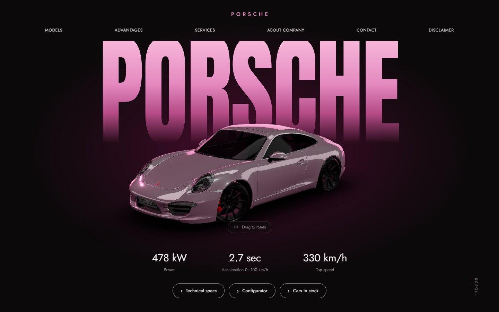
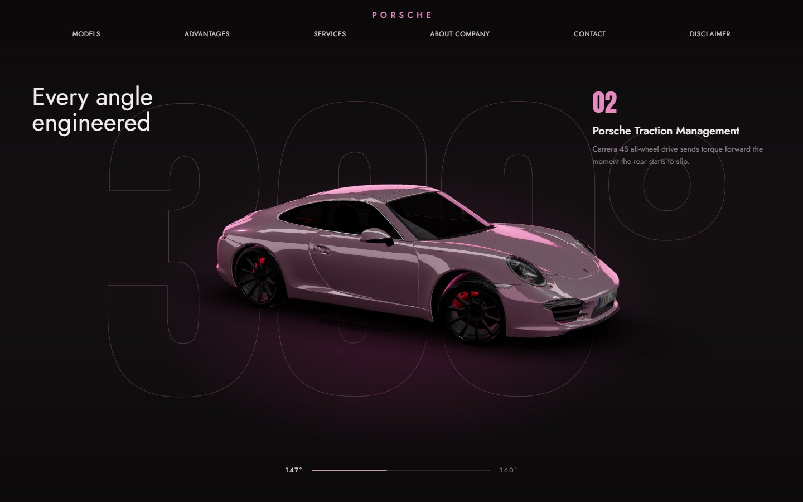
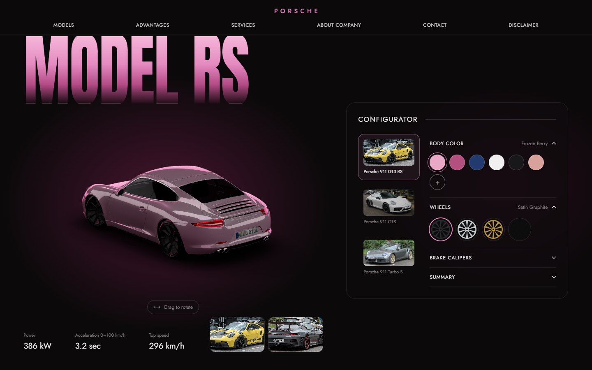
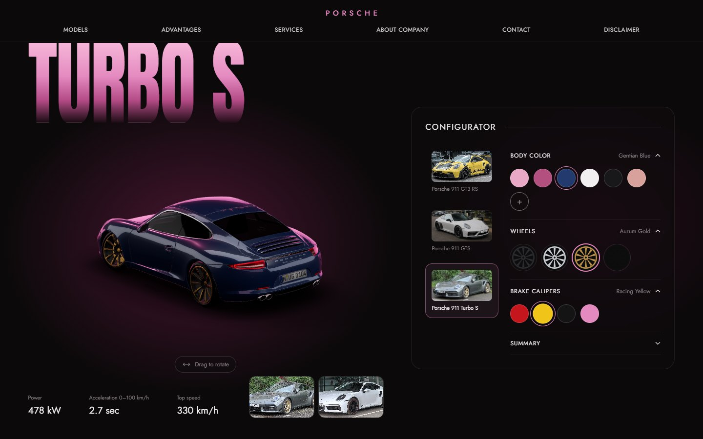
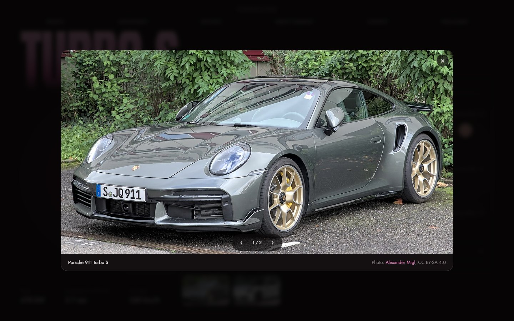
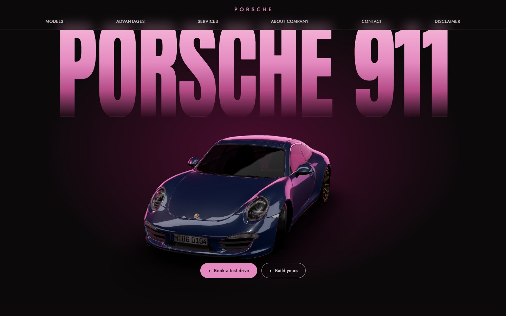
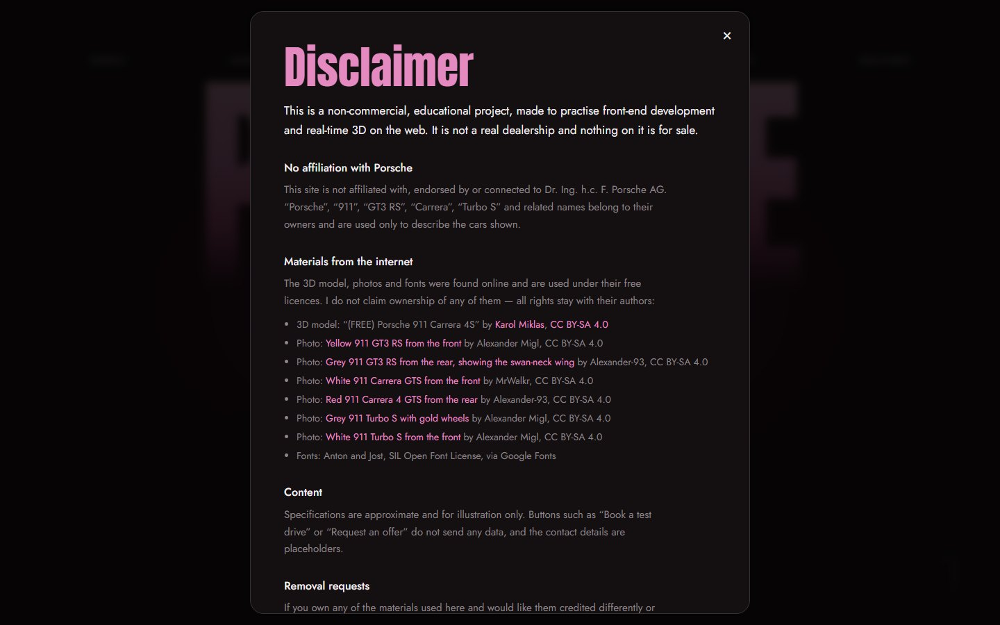
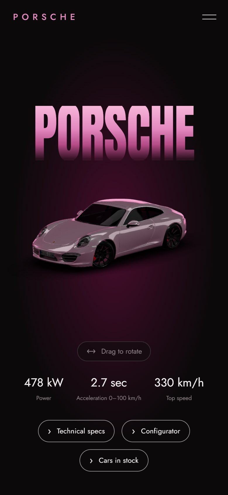
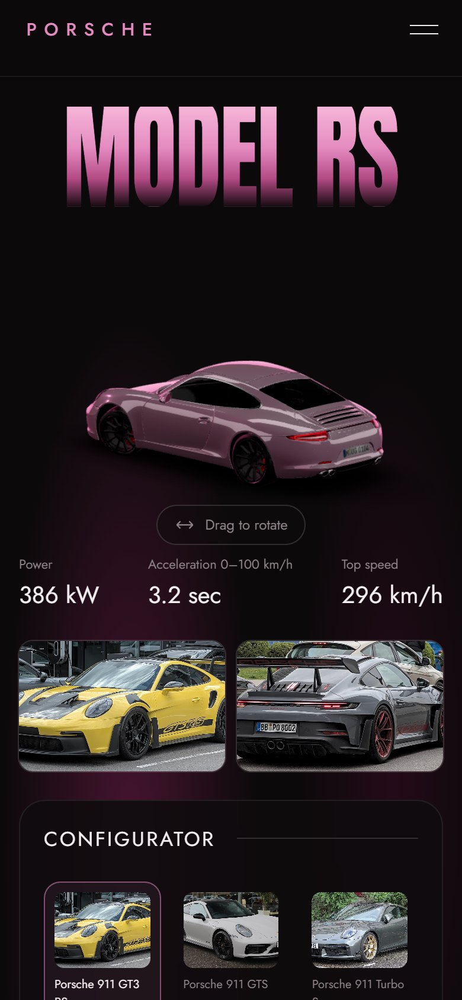

# Porsche 911 — Concept Showroom

A dark, pink-accented concept website for the Porsche 911 family, built around a real-time 3D car.
The car drives in on load, turns 360° as you scroll, can be spun by hand, and is repainted live by the configurator.



> **Educational, non-commercial project.** Not affiliated with, endorsed by or connected to Porsche AG.
> All third-party materials belong to their authors — see the in-site [Disclaimer](#disclaimer) and [Credits](#credits-and-licences).

## Contents

- [Features](#features)
- [Screenshots](#screenshots)
- [Controls](#controls)
- [Tech stack](#tech-stack)
- [Getting started](#getting-started)
- [Project structure](#project-structure)
- [How it works](#how-it-works)
- [Customisation](#customisation)
- [Deployment](#deployment)
- [Browser support](#browser-support)
- [Troubleshooting](#troubleshooting)
- [Disclaimer](#disclaimer)
- [Credits and licences](#credits-and-licences)

## Features

- **Scroll-driven 3D car.** The car moves between camera poses as you scroll, including a pinned section where it makes a full 360° turn while feature captions change.
- **Drag to rotate.** On the hero and in the configurator you can spin the car with the mouse, a finger or the ← → keys. It keeps some inertia after you let go and returns to the default pose when you scroll on.
- **Live configurator.** Choose the body paint (presets or any custom colour), the wheel finish and the brake caliper colour. Colours blend smoothly on the 3D model.
- **Three models.** The 911 GT3 RS, 911 GTS and 911 Turbo S each have their own headline, specs, photos and, optionally, their own 3D file (see [Per-model 3D files](#per-model-3d-files)).
- **Photo viewer.** Each model has two photos. They open full screen, can be browsed with the keyboard and credit the photographer.
- **Intro sequence.** A loader, rising headline letters and a drive-in with rolling wheels.
- **Disclaimer page.** It explains that this is an educational project and credits every third-party asset. Open it from the nav, the footer or `/#disclaimer`.
- **Responsive.** Mobile has its own camera poses, a burger menu and touch-friendly controls.
- **Accessible.** Keyboard focus is visible, rotation and the dialogs work from the keyboard, and `prefers-reduced-motion` is respected (no intro or parallax).

## Screenshots

| 360° section | Configurator |
| --- | --- |
|  |  |
| **Turbo S with gold wheels and yellow calipers** | **Photo viewer** |
|  |  |
| **Finale** | **Disclaimer** |
|  |  |

| Mobile — hero | Mobile — configurator |
| --- | --- |
|  |  |

## Controls

| Action | Mouse | Touch | Keyboard |
| --- | --- | --- | --- |
| Rotate the car (hero, configurator) | Drag sideways | Swipe sideways | Focus the car area with <kbd>Tab</kbd>, then <kbd>←</kbd> <kbd>→</kbd> |
| Move through the story | Scroll | Swipe up / down | <kbd>Space</kbd>, <kbd>Page Down</kbd>, arrows |
| Pick a model, colour or wheel | Click | Tap | <kbd>Tab</kbd> + <kbd>Enter</kbd> |
| Browse photos in the viewer | Click ‹ › | Tap ‹ › | <kbd>←</kbd> <kbd>→</kbd> |
| Close the photo viewer / disclaimer | Click outside or × | Tap × | <kbd>Esc</kbd> |

## Tech stack

| Area | Library |
| --- | --- |
| UI | [React 19](https://react.dev) + [Vite 7](https://vite.dev) |
| 3D | [three.js](https://threejs.org), [React Three Fiber](https://r3f.docs.pmnd.rs), [drei](https://drei.docs.pmnd.rs) |
| Animation | [GSAP](https://gsap.com) + ScrollTrigger, `@gsap/react` |
| Assets | glTF/GLB with Draco geometry and WebP textures, compressed with [gltf-transform](https://gltf-transform.dev) |

## Getting started

Requires Node.js 18 or newer.

```bash
npm install
npm run dev           # dev server on http://localhost:5173
npm run build         # production build into dist/
npm run build:pages   # production build for https://<user>.github.io/Porshe-website/
npm run preview       # serve the last build locally
```

## Project structure

```
docs/screenshots/     images used in this README
public/
  draco/              Draco decoder (served locally, no CDN needed)
  images/             model photos (Wikimedia Commons)
  models/             3D models + licence file
src/
  config.js           models, colours, wheel finishes, camera poses, 3D part matchers
  rig.js              scroll progress → car pose, drag state
  App.jsx             state, ScrollTrigger stages, pinned 360° timeline, intro
  styles.css          all styles (design tokens at the top)
  components/
    Scene.jsx         fixed full-screen canvas, lights, studio environment
    Car.jsx           model loading, normalisation, wheel pivots, live recolouring, drag inertia
    DragZone.jsx      pointer / keyboard rotation layer
    Hero.jsx          first screen
    Spin.jsx          pinned 360° section
    Models.jsx        model stage + configurator
    Gallery.jsx       model photos + full-screen viewer
    Finale.jsx        closing section, services, footer, credits
    Disclaimer.jsx    educational-use notice and asset credits (#disclaimer)
    Nav.jsx, Loader.jsx, Mega.jsx
```

## How it works

**Layering.** The page is stacked in four layers: glow backgrounds, then the giant headlines, then one fixed WebGL
canvas, then the UI. That puts the car *in front of* the huge type and *behind* the buttons and panels, as in the
original mockup. The canvas ignores pointer events, so separate transparent `DragZone` layers catch the drags.

**Scroll choreography.** Several tweens animating the same object would fight each other, so each scroll stage
only records its progress (0–1):

| Stage | Trigger | Effect |
| --- | --- | --- |
| `p[0]` | `#spin` enters | hero pose → side view |
| `p[1]` | `#spin` pinned (220% of viewport) | full 360° turn, captions, degree meter |
| `p[2]` | `#models` enters | car moves beside the configurator |
| `p[3]` | `#finale` enters | front three-quarter view under "PORSCHE 911" |
| `p[4]` | `#services` enters | car scrolls away with the page |

On every frame, `currentPose()` in `src/rig.js` turns these values into a target pose. `Car.jsx` then eases
towards that pose and adds the visitor's drag rotation on top. Motion stays smooth, and React never re-renders
while you scroll.

**Drag rotation.** `DragZone` adds the horizontal pointer movement to a shared yaw value and remembers the speed
at release. The car keeps turning briefly after you let go, then slows to a stop. Drag only works while the car
rests in the hero or the configurator. Once you scroll on, the yaw resets and any full turns are cancelled out,
so the car never spins back the long way.

**Model normalisation.** Any GLB is centred, set on the ground, scaled to a fixed length and turned so its length
runs along the z-axis. Each wheel node gets a new pivot at the centre of its bounding box, so it rolls in place.

**Performance.** Measured at 46 draw calls and about 348k triangles per frame, steady at 60 fps on a desktop GPU.
This comes from:
- Draco + WebP assets (21 MB → 1.5 MB)
- transmission disabled on glass
- single-pass transparent materials
- shaders compiled with `compileAsync` before the intro
- no allocations in the frame loop
- a capped pixel ratio

## Customisation

All content lives in [`src/config.js`](src/config.js).

- **Colours:** `BODY_COLORS`, `RIM_FINISHES` (colour, metalness, roughness) and `CALIPER_COLORS`.
- **Models:** `MODELS`, which holds each model's name, headline, specs, default paint, 3D file and photos.
- **Camera poses:** `POSES.desktop` and `POSES.mobile`. Each section sets `x` (fraction of half the viewport width), `y`, `rotY`, `rotX` and `scale`.
- **Asset paths:** wrap paths in `asset('…')` so they resolve against Vite's `base` (needed for sub-path hosting).
- **Design tokens:** the CSS custom properties at the top of [`src/styles.css`](src/styles.css).

### Per-model 3D files

Each entry in `MODELS` points to its own file: `models/gt3rs.glb`, `models/gts.glb` or `models/turbos.glb`.
On load the app sends a HEAD request for each one. If a file is missing, that model uses the shared Carrera 4S.

To add a model:

1. Put the `.glb` in `public/models/` under the expected name.
2. Compress it, keeping mesh names intact so the configurator can find parts:
   ```bash
   npx @gltf-transform/cli optimize source.glb public/models/gt3rs.glb \
     --compress draco --texture-compress webp --texture-size 1024 \
     --simplify-error 0.0001 --simplify-ratio 0.5 \
     --join false --flatten false --instance false --palette false
   ```
3. Check the part names (for example at [gltf.report](https://gltf.report)) and set the model's `match` rules in
   `config.js`: `body`, `rims`, `calipers`, `glass` and `wheels`. Each rule is a regex on the mesh or material name.
   GLTFLoader strips dots, so `Cylinder.000` becomes `Cylinder000`.
4. Set `rotationY` to `0` or `Math.PI` so the nose faces the camera.
5. Add the model's author and licence to `Finale.jsx`, `Disclaimer.jsx` and the [credits](#credits-and-licences).

### Photos

Photos live in `public/images/<model>-1.jpg` and `-2.jpg`. Each photo's author, licence and source link are stored
in `MODELS[].photos` and shown in the photo viewer and on the Disclaimer page, so keep that metadata accurate when
you swap a photo.

## Deployment

The build output in `dist/` is a fully static site, so any static host works.

- **Netlify, Vercel, Cloudflare Pages, or any domain root:** build command `npm run build`, publish directory `dist`.
- **GitHub Pages (project site):** the site is served from `/Porshe-website/`, so build with the matching base:
  1. Run `npm run build:pages`.
  2. Publish the contents of `dist/` to a `gh-pages` branch (for example with `npx gh-pages -d dist`), or upload
     them with the official *Deploy to GitHub Pages* Actions workflow.
  3. In **Settings → Pages**, choose that branch or workflow as the source.

  If you fork under a different repository name, change `--base` in the `build:pages` script to match.

## Browser support

The site needs WebGL 2, the `<dialog>` element and ES2020. All current Chromium-based browsers, Firefox and Safari
support these. It was tested in Microsoft Edge (Chromium) on desktop and in a 390 px mobile viewport; it has not
been tested on physical iOS or Android devices yet.

## Troubleshooting

| Problem | Fix |
| --- | --- |
| The car never appears or the loader stays up | Check the browser console. The model and Draco decoder must load from `models/` and `draco/` under the site's base path. |
| `--base=/Porshe-website/` turns into `C:/Program Files/Git/...` | Git Bash on Windows rewrites Unix-style arguments. Use `npm run build:pages`, or prefix the command with `MSYS_NO_PATHCONV=1`. |
| A new model shows the Carrera instead | The HEAD check found no file. Check the file name, and make sure the server doesn't answer missing files with `index.html`. |
| Colours don't change on a new model | The `match` regexes don't fit that model's mesh or material names. Inspect the file and update them in `config.js`. |
| Wheels roll backwards | Set `wheelDirection: -1` for that model. |

## Disclaimer

This is a non-commercial, educational project, made to practise front-end development and real-time 3D on the web.
It is not a real dealership, and nothing on it is for sale.

- It is not affiliated with, endorsed by or connected to Dr. Ing. h.c. F. Porsche AG. "Porsche", "911", "GT3 RS",
  "Carrera", "Turbo S" and related names belong to their owners and are used only to describe the cars shown.
- The 3D model, photos and fonts were found online and are used under their free licences. No ownership of them is
  claimed; all rights stay with their authors.
- Specifications are approximate. Buttons such as "Book a test drive" don't send any data, and the contact details
  are placeholders.
- If you own any of the materials and would like them credited differently or removed, please
  [open an issue](https://github.com/Or1van/Porshe-website/issues).

## Credits and licences

Third-party assets keep their own licences. Their credits are shown on the site and must stay if you reuse them.

**3D model.** "(FREE) Porsche 911 Carrera 4S" by [Karol Miklas](https://sketchfab.com/karolmiklas)
([source](https://sketchfab.com/3d-models/free-porsche-911-carrera-4s-d01b254483794de3819786d93e0e1ebf)),
licensed under [CC BY-SA 4.0](http://creativecommons.org/licenses/by-sa/4.0/). It has been compressed for the
web; see [`public/models/LICENSE-porsche-911.txt`](public/models/LICENSE-porsche-911.txt).

**Photos.** From Wikimedia Commons, licensed under [CC BY-SA 4.0](https://creativecommons.org/licenses/by-sa/4.0/):

| File | Author |
| --- | --- |
| [Porsche 992 GT3 RS DSC 9055](https://commons.wikimedia.org/wiki/File:Porsche_992_GT3_RS_DSC_9055.jpg) | Alexander Migl |
| [Porsche 911 GT3 RS (2022) 1X7A7164](https://commons.wikimedia.org/wiki/File:Porsche_911_GT3_RS_(2022)_1X7A7164.jpg) | Alexander-93 |
| [Porsche 911 (992) Carrera GTS](https://commons.wikimedia.org/wiki/File:Porsche_911_(992)_Carrera_GTS.jpg) | MrWalkr |
| [Porsche 992 Carrera 4 GTS 1X7A7209](https://commons.wikimedia.org/wiki/File:Porsche_992_Carrera_4_GTS_1X7A7209.jpg) | Alexander-93 |
| [Porsche 992 Turbo S 1X7A6046 (cropped)](https://commons.wikimedia.org/wiki/File:Porsche_992_Turbo_S_1X7A6046_(cropped).jpg) | Alexander Migl |
| [Porsche 992 Turbo S 1X7A0411](https://commons.wikimedia.org/wiki/File:Porsche_992_Turbo_S_1X7A0411.jpg) | Alexander Migl |

**Fonts.** [Anton](https://fonts.google.com/specimen/Anton) and [Jost](https://fonts.google.com/specimen/Jost)
(SIL Open Font License), via Google Fonts.

**Libraries.** React, Vite, three.js, React Three Fiber, drei and GSAP, each under its own licence (see
`node_modules/<package>/LICENSE`).
